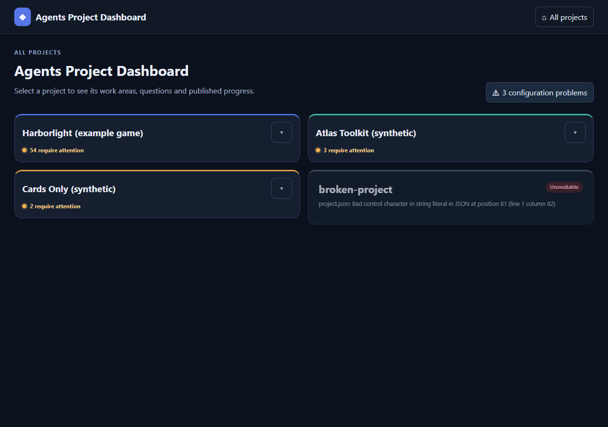
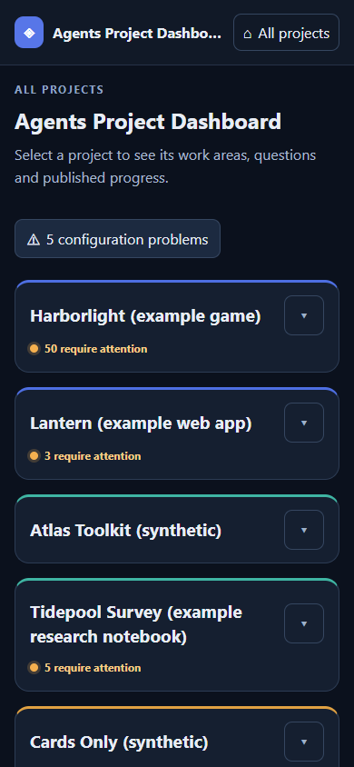
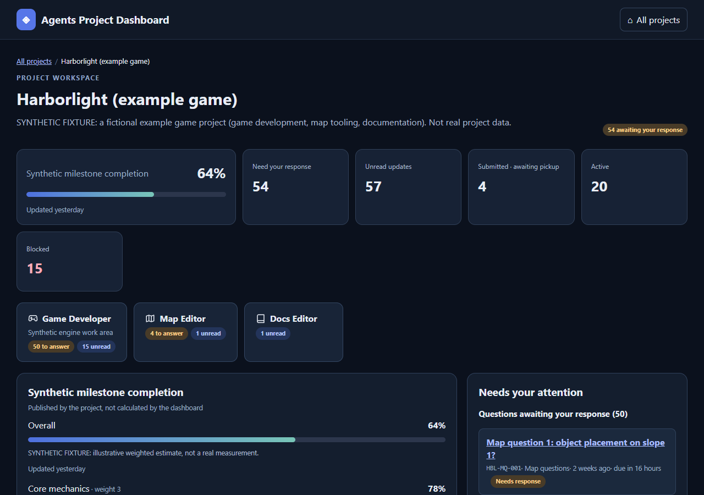
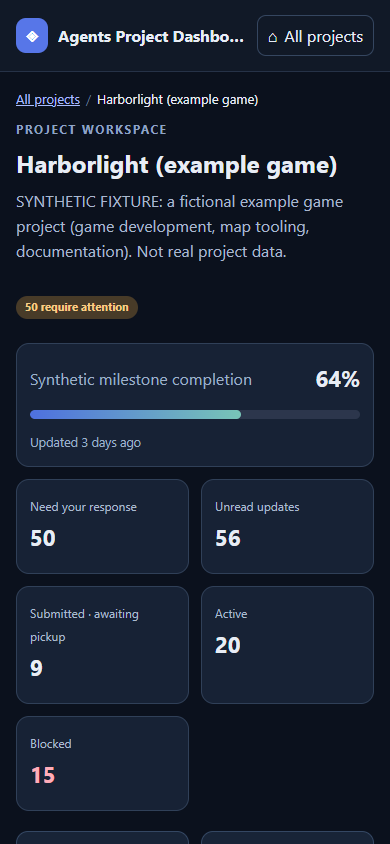
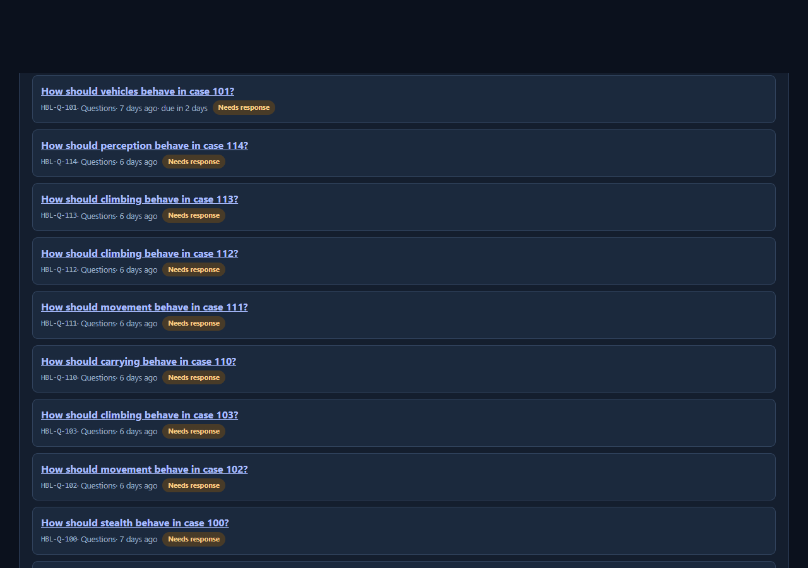
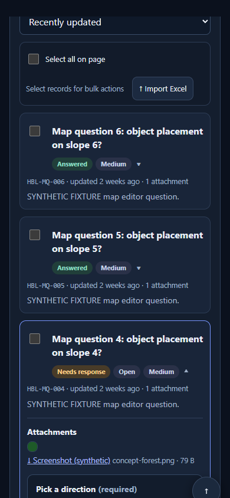
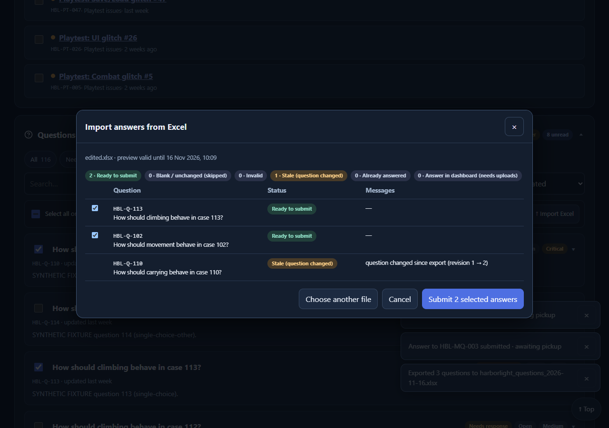
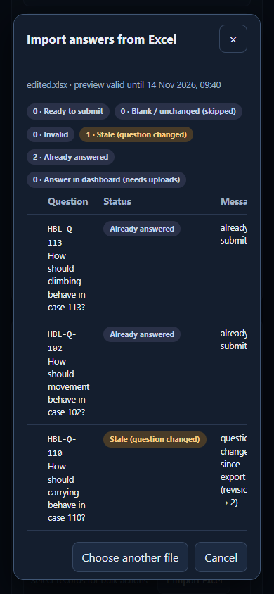
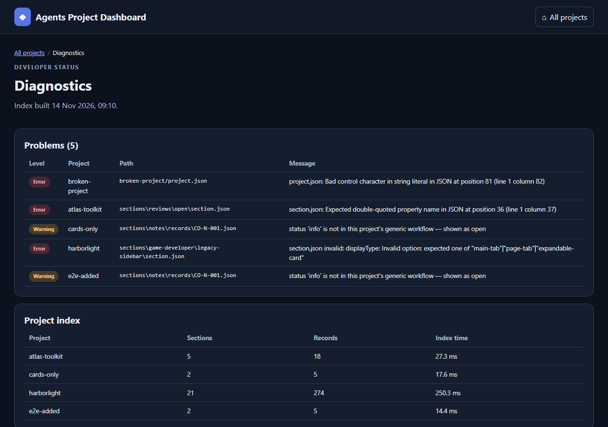
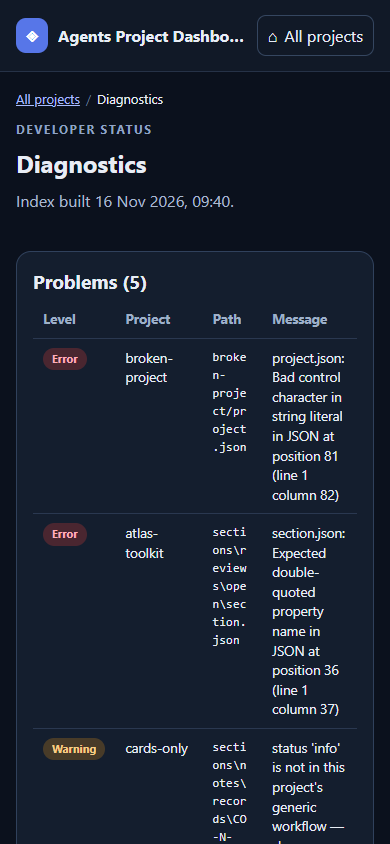

# agents-project-dashboard

A small, self-hosted dashboard that gives each of your projects one place to publish questions, tasks, issues,
reviews, progress and activity, and one place for you to answer, review and download. It reads plain JSON files from
folders you control and writes answers to a file queue that any script, agent or person can consume.

It is **project-independent**. A project is just a folder with a `project.json` and a few section manifests; the
dashboard has no built-in knowledge of any language, framework, game, version control system or AI tool. The producer
can be a CI job, a shell script, a person editing files, or an AI coding agent. Nothing in the frontend, backend or
data format depends on any of them.

> **Status:** pre-release. The dashboard, API, queue, Excel round trip and examples work and are tested. The Docker
> image and deploy script are tested on linux/amd64 and linux/arm64. The agent kit (CLI and skills) is tested against
> the API, and all four skills were run in Claude Code and Codex CLI (see [Limitations](#limitations)).

## What it does

- **Projects discovered from folders.** No shared registry file; each project owns its own configuration, title,
  layout and data. Add a folder and it appears.
- **Manifest-driven navigation** with three display types: `main-tab`, `page-tab` and `expandable-card`. Titles, order,
  icons and nesting come from JSON, so two projects can look completely different without code changes.
- **Records with stable ids:** questions, tasks, issues, reviews, progress, activity, documents and generic records,
  with attachments, links, history and Markdown bodies loaded on demand.
- **Questions you can answer in the UI:** single choice, multiple choice, free text, approvals, file uploads, and
  composites. Answers are validated on the server and enter a file queue.
- **Answer queue with leases:** pending, processing, processed, failed; claim, complete, fail and retry; at-least-once
  delivery with crash recovery. Consumers list compact ids and never scan old question files.
- **Real `.xlsx` export and import** with a preview step; invalid, stale or duplicate rows never overwrite anything.
- **Uploads, downloads and ZIPs** of selected attachments.
- **Published progress**, never computed: "Not reported" is shown when a project publishes nothing.
- **Per-project status workflows** with categories that drive counts and colours ([ADR 0008](docs/adr/0008-configurable-status-workflows.md)).
- **Unread updates and awaiting-response counts** tracked independently, with live updates over Server-Sent Events.
- **Agent integration:** a publish API, scoped bearer tokens, a single-file CLI with an offline outbox, and four
  portable skills for coding agents ([docs/AGENT_INTEGRATION.md](docs/AGENT_INTEGRATION.md), [docs/SKILLS.md](docs/SKILLS.md)).
- **Secure by default:** loopback-only, token authentication and HTTPS enforced for any other bind address, path
  containment with symlink protection, sanitised Markdown, upload and Excel limits.

## Screenshots

All screenshots show **synthetic example data** from a fictional project, generated from this repository's fixtures by
the end-to-end test. They illustrate the interface; they are not a live deployment.

| Desktop | Mobile |
|---|---|
|  |  |
|  |  |
|  |  |
|  |  |
|  |  |

## Prerequisites and configuration

- Node.js 22 or newer, npm. Linux, macOS and Windows. No database or external service.
- Configuration is environment variables or an optional `pcc.config.json`. The ones you need first:

| Variable | Default | Meaning |
|---|---|---|
| `PCC_DATA_ROOT` | required | Folder that contains `projects/` |
| `PCC_HOST` | `127.0.0.1` | Bind address. Anything else requires a token and HTTPS |
| `PCC_PORT` | `8790` | Port |
| `PCC_WEB_ROOT` | none | Built UI folder, `dist/web` |
| `PCC_AUTH_TOKEN_FILE` | none | File with the access token; turns login on |
| `PCC_TLS_CERT`, `PCC_TLS_KEY` | none | PEM files for built-in HTTPS |
| `PCC_BEHIND_HTTPS_PROXY` | off | `1` when a TLS proxy on the same host fronts the app |
| `PCC_CONFIG` | `./pcc.config.json` | Config file path |

Full table (upload limits, session lifetime, log level, extra project roots): [docs/DEPLOYMENT.md](docs/DEPLOYMENT.md#configuration).

## Quick start

```sh
git clone <repository-url> agents-project-dashboard
cd agents-project-dashboard
npm ci
npm run build
cp -r examples demo-data          # the server writes into its data root, so use a copy
PCC_DATA_ROOT=demo-data PCC_WEB_ROOT=dist/web npm start
```

Open **http://127.0.0.1:8790**: two fictional example projects with different layouts. Windows PowerShell syntax and
creating your own project: [docs/GETTING_STARTED.md](docs/GETTING_STARTED.md).

## Docker

`Dockerfile` and `docker-compose.yml` are provided with a named data volume, a configurable port, secrets for the token
and TLS certificate, a non-root user, and the port published on loopback only. `deploy/apd-deploy.sh` does the rest on
Linux and macOS hosts:

```sh
deploy/apd-deploy.sh up --demo        # or `up` for an empty dashboard; creates the token and a self-signed certificate
deploy/apd-deploy.sh health --auth
deploy/apd-deploy.sh backup           # also: upgrade, rollback, restore, reset (the last two ask for confirmation)
```

Image build, startup and every script command are tested on linux/amd64 and linux/arm64 (CI runs
`deploy/test-deploy.sh` on both; also run on a Raspberry Pi). Windows hosts: use WSL or Docker Desktop with a bash shell (not tested). Commands, settings and upgrade notes:
[docs/DEPLOYMENT.md](docs/DEPLOYMENT.md#deploy-script).

## Self-hosting

Bind address, HTTPS (built-in or reverse proxy), the token file, permissions, backups, restore and an exposure
checklist: [docs/DEPLOYMENT.md](docs/DEPLOYMENT.md). The server refuses to listen beyond loopback without a token and
HTTPS. Remote agents need either shared storage for the data folder or the authenticated HTTP API; a local setup is
never reachable from another computer by default, and the hosting options are not equally secure or durable.

## Onboarding a project

A project is `<dataRoot>/projects/<folder>/project.json` plus `sections/<...>/section.json` manifests and records.
No code changes, no registry. Minimal example in [docs/GETTING_STARTED.md](docs/GETTING_STARTED.md#3-create-your-own-project);
everything about it is in [docs/PROJECT_FORMAT.md](docs/PROJECT_FORMAT.md): display types and allowed nesting, ordering,
published progress, notifications, status workflows, record types and schemas, question types (options, free text,
approvals, uploads), attachments, stable ids, and every validation message. Two complete projects are in
[examples/](examples/README.md).

## Questions, answers and the queue

Producers write question files; users answer in the UI (or Excel); answers become one file each in
`communications/answers/pending/`; a consumer lists pending ids, claims one under a lease, and completes or fails it.
Delivery is at-least-once, so consumers must be idempotent. The contract, failure and crash behavior, and a
copy-and-paste walkthrough are in [docs/QUEUE.md](docs/QUEUE.md).

## Agents and scripts

Agents on the same machine can write files; agents anywhere else use the publish API with a scoped token (one project,
only the scopes it needs). The `agent-kit/` folder has the `apd` CLI (one file, no dependencies), four skills
(ask a question, process answers, update progress, report issues), optional Claude Code and `AGENTS.md` snippets, and
example inputs. `npm run demo:agent` runs the whole loop on the example project. Guide:
[docs/AGENT_INTEGRATION.md](docs/AGENT_INTEGRATION.md); skills and installation: [docs/SKILLS.md](docs/SKILLS.md).

## Excel, uploads and downloads

Export questions to a real `.xlsx` workbook, fill it in, preview the import, then commit. See [docs/EXCEL.md](docs/EXCEL.md).
Uploads (type allowlist, content check, size limits) and ZIP downloads of attachments are described in
[docs/SECURITY_MODEL.md](docs/SECURITY_MODEL.md) and [docs/API.md](docs/API.md).

## HTTP API

Every UI action is an API call. Reference, request and response shapes, errors, authorization and limits:
[docs/API.md](docs/API.md). Rate limiting exists only for failed logins.

## Tests

```sh
npm test                    # all Vitest tests (backend integration + web unit)
npm run test:unit           # web components and shared logic
npm run test:integration    # backend against real temporary folders
npm run test:e2e            # builds the UI and drives it in a headless Chromium-based browser
npm run lint && npm run typecheck && npm run build
npm run coverage            # V8 coverage report in coverage/
```

What they cover and how to troubleshoot failures: [docs/GETTING_STARTED.md](docs/GETTING_STARTED.md#tests-and-quality-checks).
Tests use temporary folders and synthetic data only. Coverage numbers are produced by `npm run coverage` on your machine;
this README does not quote one.

## Performance

The server keeps an in-memory index of record summaries, serves paged lists, loads record detail lazily, updates
incrementally from a file watcher and Server-Sent Events, and the UI caches queries between tab switches. How to
measure and diagnose slow loads: [docs/PERFORMANCE.md](docs/PERFORMANCE.md).

## Security

Trust boundaries, access restrictions, path and symlink containment, upload and Excel limits, rendering rules and what
is *not* protected: [docs/SECURITY_MODEL.md](docs/SECURITY_MODEL.md). Reporting a vulnerability: [SECURITY.md](SECURITY.md).
Do not expose the server to a network without a token and HTTPS, and read the
[exposure checklist](docs/DEPLOYMENT.md#exposure-checklist).

## Limitations

Known limitations are in [docs/LIMITATIONS.md](docs/LIMITATIONS.md). In particular:

- **No consumer runs inside the dashboard,** and it cannot push messages into a running agent session; agents check
  the queue at work boundaries with the CLI or skills in `agent-kit/`.
- The skills were run in Claude Code and Codex CLI on Windows only, one model each.
- Single shared human access level; per-project limits exist only for scoped agent tokens.
- Docker is tested on Linux hosts (amd64, arm64); macOS and Windows hosts are not tested.
- Extensions can build on the publish and queue APIs, the update event stream and the closed schema lists
  (see [extension points](docs/LIMITATIONS.md#extension-points)).

## Documentation map

[Getting started](docs/GETTING_STARTED.md) · [Project format](docs/PROJECT_FORMAT.md) · [Queue](docs/QUEUE.md) ·
[Agent integration](docs/AGENT_INTEGRATION.md) · [Skills](docs/SKILLS.md) · [Agent kit](agent-kit/README.md) ·
[Excel](docs/EXCEL.md) · [API](docs/API.md) · [Deployment](docs/DEPLOYMENT.md) · [Security model](docs/SECURITY_MODEL.md) ·
[Performance](docs/PERFORMANCE.md) · [Limitations](docs/LIMITATIONS.md) · [Decisions (ADRs)](docs/adr/) ·
[Third-party licenses](docs/THIRD_PARTY_LICENSES.md) · [Examples](examples/README.md)

## Contributing and license

See [CONTRIBUTING.md](CONTRIBUTING.md). Licensed under the [Apache License, Version 2.0](LICENSE).
Third-party dependency licenses are reviewed in [docs/THIRD_PARTY_LICENSES.md](docs/THIRD_PARTY_LICENSES.md).
